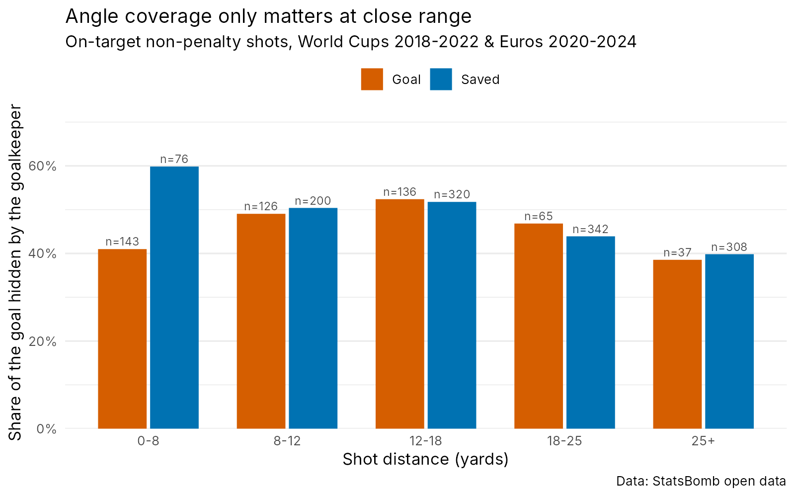

# Placement du gardien et expected saves

*[English version](README.md)*

**La position du gardien au moment de la frappe change-t-elle ses chances d'arrêt, et dans quelles situations ?**

Ce dépôt est un prototype exploratoire construit sur les données ouvertes de StatsBomb. Il ajuste un modèle d'*expected saves* (xSaves) qui, en plus des caractéristiques habituelles du tir, décrit la position du gardien par rapport au tir : sortie, écart à la bissectrice et part du but qu'il cache au tireur.

## Résultats clés

- **La position du gardien apporte beaucoup d'information.** Ajouter les variables du gardien à un modèle « tir seul » fait passer l'AUC hors échantillon de **0,760 à 0,895** (score de Brier 0,168 → 0,116), en validation croisée à 5 blocs groupés par match.
- **La couverture de l'angle ne compte que de près.** Sur les tirs à moins de 8 yards, les gardiens qui ont arrêté le ballon cachaient **60 %** du but au tireur, contre **41 %** quand ils ont encaissé (test de Wilcoxon, p < 10⁻⁵). Au-delà de 8 yards, aucune différence.
- **L'effet tient après ajustement.** Dans la régression logistique, l'interaction couverture × tir proche est positive et significative (**β = 3,09, p = 0,005**), à distance, angle, tête, hauteur du tir, défenseurs dans le triangle de tir, écart à la bissectrice et point d'arrivée du ballon égaux. De près, cacher 10 points de pourcentage de but en plus multiplie la cote d'un arrêt par environ **1,28**.

C'est cohérent avec l'entraînement des gardiens : sur un face-à-face, il n'y a pas le temps de plonger, donc ce qui compte, c'est la part du but que le corps couvre déjà (fermer l'angle, sortie en croix, blocage). De plus loin, la réaction et le plongeon priment.



## Données

- **Source :** [StatsBomb open data](https://github.com/statsbomb/open-data) : Coupes du monde 2018 et 2022, Euros 2020 et 2024.
- **Échantillon :** 1 753 tirs cadrés hors penalties (507 buts, 1 246 arrêts). Cinq tirs où le gardien était à plus de 18 yards de sa ligne sont exclus du modèle.
- **Positions :** *freeze frames* StatsBomb, c'est-à-dire la position de chaque joueur visible au moment du tir.

## Variables

| Variable | Description |
|---|---|
| `distance`, `angle` | Distance au centre du but et ouverture du but vue par le tireur |
| `tete`, `hauteur` | Tir de la tête ; hauteur du ballon au passage de la ligne |
| `n_def_devant` | Défenseurs dans le triangle ballon–poteau–poteau |
| `gk_sortie` | Distance du gardien à sa ligne (sortie) |
| `gk_decal` | Distance du gardien à la bissectrice de l'angle de tir |
| `gk_couv` | **Part du but cachée par le gardien** : son envergure (±1,5 yard) projetée depuis le ballon sur la ligne de but |
| `ecart_arrivee` | Écart latéral entre le gardien et le point où le ballon franchit la ligne |

## Modèles

Régressions logistiques comparées en validation croisée à 5 blocs groupés par match (un modèle n'est jamais évalué sur un match vu à l'entraînement).

| Modèle | AUC | Brier |
|---|---|---|
| Variables du tir seules | 0,760 | 0,168 |
| + sortie du gardien, écart à la bissectrice, écart à l'arrivée | 0,895 | 0,116 |
| + couverture du gardien (à la place de la sortie) | 0,892 | 0,118 |
| + couverture × tir proche (< 8 yards) | 0,894 | 0,117 |

Le modèle avec interaction n'améliore pas la discrimination globale, car les tirs proches représentent une petite part de l'échantillon. Son intérêt est d'interprétation : il isole un effet de la couverture invisible dans les données agrégées. Les prédictions hors échantillon sont bien calibrées (`figures/calibration.png`).

## Limites

- **Pas de posture du corps.** Les freeze frames donnent la position au sol de chaque joueur, pas ses appuis, la position de ses bras ni s'il était posé.
- **`ecart_arrivee` mélange deux choses :** la précision du tireur et le placement du gardien.
- **Le tireur s'adapte au gardien.** Il vise le côté que le gardien laisse ouvert : placement et point d'arrivée ne sont donc pas indépendants.
- **Envergure fixe.** La couverture suppose la même envergure (±1,5 yard) pour tous les gardiens et à toutes les distances.
- **Taille d'échantillon.** Uniquement des tournois ; le sous-groupe des tirs proches compte environ 220 tirs.

## Travail en cours et suite

1. **Séparer le placement de l'arrêt.** Pour chaque tir, comparer la probabilité d'arrêt à la position réelle du gardien avec celle à la position « de manuel » (sur la bissectrice, même profondeur). Chaque tir tombe alors dans une de quatre situations : bien placé / mauvais plongeon, mal placé / superbe arrêt, bien placé / bon arrêt, mal placé / mauvais plongeon.
2. **Actions du gardien.** Ajouter les événements gardien de StatsBomb (plongeon ou debout, partie du corps utilisée, posé ou en mouvement au moment de la frappe).
3. **Pose du corps et données de tracking.** Estimer la posture du gardien à partir de la vidéo ou du tracking pour modéliser directement ses appuis et son envergure.
4. **Interaction tireur–gardien.** Modéliser le choix du tireur comme une réponse au placement du gardien, au lieu de considérer le point d'arrivée comme fixe.

## Reproduire l'analyse

R ≥ 4.3 avec `tidyverse`, `pROC` et [`StatsBombR`](https://github.com/statsbomb/StatsBombR) :

```r
install.packages(c("remotes", "tidyverse", "pROC"))
remotes::install_github("statsbomb/StatsBombR")
```

Puis lancer les scripts dans l'ordre, depuis la racine du projet :

```
R/01_extract_shots.R   # téléchargement, tirs cadrés -> tirs.rds
R/02_features.R        # variables, test sur les tirs proches, figure de couverture
R/03_model.R           # modèles en validation croisée, modèle final, calibration
```

## Auteur

**Elliot Houdant**, Master Data Science en Santé, Université de Lille. Ancien analyste data et vidéo et éducateur au centre de formation de l'Amiens SC.

## Crédit des données

Données fournies par [StatsBomb](https://statsbomb.com/) via son dépôt de données ouvertes.
