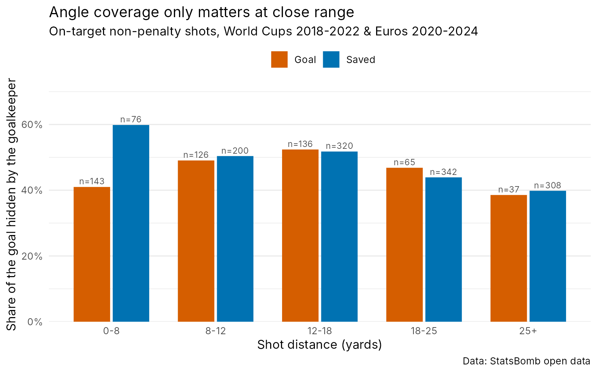

# Goalkeeper positioning and expected saves

*[Version française](README.fr.md)*

**Does where the goalkeeper stands at the moment of the shot change the odds of a save, and when?**

This repository is an exploratory prototype built on StatsBomb open data. It fits an expected saves (xSaves) model that, alongside the usual shot features, describes the goalkeeper's position relative to the shot: depth off the line, distance from the angle bisector, and the share of the goal he hides from the shooter.

## Key findings

- **Goalkeeper position adds a lot of information.** Adding goalkeeper features to a shot-only model raises the out-of-fold AUC from **0.760 to 0.895** (Brier score 0.168 → 0.116), with 5-fold cross-validation grouped by match.
- **Angle coverage only matters at close range.** On shots from within 8 yards, goalkeepers who made the save were hiding **60%** of the goal from the shooter, against **41%** when they conceded (Wilcoxon test, p < 10⁻⁵). Beyond 8 yards, there is no difference.
- **The effect holds after adjustment.** In the logistic model, the coverage × close-range interaction is positive and significant (**β = 3.09, p = 0.005**), controlling for distance, angle, header, shot height, defenders in the shooting triangle, distance from the bisector and where the ball crossed the line. At close range, hiding 10 more percentage points of the goal multiplies the odds of a save by about **1.28**.

This is consistent with goalkeeping coaching: in one-on-ones there is no time to dive, so what counts is how much of the goal the body already covers (closing the angle, "star" or block saves). From further out, reaction and shot-stopping dominate.



## Data

- **Source:** [StatsBomb open data](https://github.com/statsbomb/open-data): FIFA World Cups 2018 and 2022, UEFA Euros 2020 and 2024.
- **Sample:** 1,753 on-target, non-penalty shots (507 goals, 1,246 saves). Five shots with the goalkeeper more than 18 yards off his line are excluded from the model.
- **Positions:** StatsBomb *freeze frames*, i.e. the location of every visible player at the moment of the shot.

## Features

| Feature | Description |
|---|---|
| `distance`, `angle` | Distance to goal centre and goal-mouth angle seen by the shooter |
| `tete`, `hauteur` | Header; ball height when crossing the goal line |
| `n_def_devant` | Defenders inside the ball–post–post triangle |
| `gk_sortie` | Goalkeeper's distance off his line (depth) |
| `gk_decal` | Goalkeeper's distance from the angle bisector |
| `gk_couv` | **Share of the goal hidden by the goalkeeper**: his reach (±1.5 yards) projected from the ball onto the goal line |
| `ecart_arrivee` | Lateral distance between the goalkeeper and the point where the ball crossed the line |

## Models

Logistic regressions compared with 5-fold cross-validation grouped by match (a model is never evaluated on a match it was trained on).

| Model | AUC | Brier |
|---|---|---|
| Shot features only | 0.760 | 0.168 |
| + goalkeeper depth, bisector offset, ball-to-GK distance | 0.895 | 0.116 |
| + goalkeeper coverage (instead of depth) | 0.892 | 0.118 |
| + coverage × close range (< 8 yards) | 0.894 | 0.117 |

The interaction model does not improve overall discrimination, because close-range shots are a small share of the sample. Its value is interpretive: it isolates a coverage effect that is hidden in the pooled data. Out-of-fold predictions are well calibrated (`figures/calibration.png`).

## Limitations

- **No body posture.** Freeze frames give each player's location on the ground, not stance, arm position or whether the goalkeeper was set.
- **`ecart_arrivee` mixes two things:** shooter accuracy and goalkeeper position.
- **Shooters adapt to goalkeepers.** A shooter picks the side the goalkeeper leaves open, so position and shot placement are not independent.
- **Fixed reach.** Coverage assumes the same reach (±1.5 yards) for every goalkeeper and every distance.
- **Sample size.** Tournament data only; the close-range subgroup has about 220 shots.

## Work in progress and next steps

1. **Separating positioning from shot-stopping.** For each shot, compare the save probability at the goalkeeper's actual position with the probability at the "textbook" position (on the bisector, same depth). Each shot then falls into one of four situations: well positioned / poor dive, poorly positioned / great save, well positioned / good save, poorly positioned / poor dive.
2. **Goalkeeper actions.** Add StatsBomb goalkeeper events (diving or standing, body part used, set or moving at the moment of the shot).
3. **Body pose and tracking data.** Estimate goalkeeper posture from video or broadcast tracking to model stance and reach directly.
4. **Shooter–goalkeeper interaction.** Model the shooter's choice as a response to goalkeeper position, rather than treating shot placement as fixed.

## Reproduce

R ≥ 4.3 with `tidyverse`, `pROC` and [`StatsBombR`](https://github.com/statsbomb/StatsBombR):

```r
install.packages(c("remotes", "tidyverse", "pROC"))
remotes::install_github("statsbomb/StatsBombR")
```

Then run the scripts in order from the project root:

```
R/01_extract_shots.R   # download events, keep on-target shots -> tirs.rds
R/02_features.R        # features, close-range test, coverage figure
R/03_model.R           # cross-validated models, final model, calibration figure
```

Variable names and code comments are in French, with English translations in the comments.

## Author

**Elliot Houdant**, MSc in Health Data Science, Université de Lille. Former data and video analyst and youth coach at Amiens SC's academy.

## Data credit

Data provided by [StatsBomb](https://statsbomb.com/) through its open data repository.
